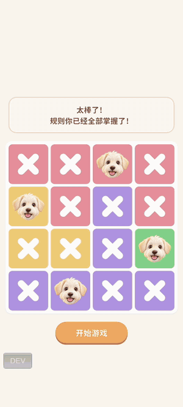
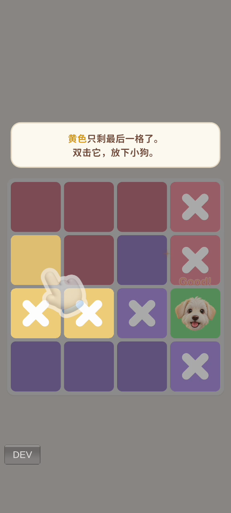
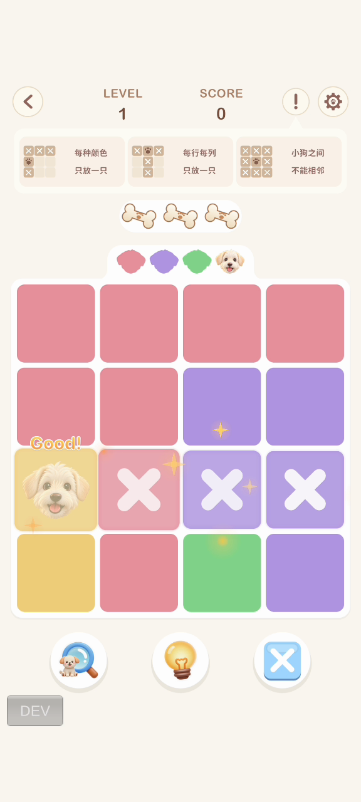
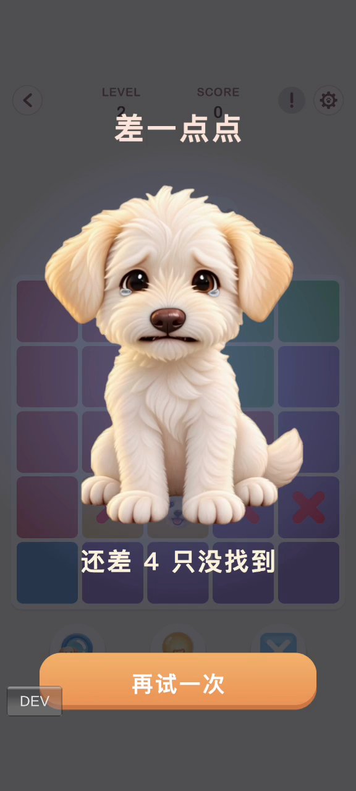

# Furrydoku

竖屏逻辑解谜手游（Android）。玩家依据行、列、颜色区域和相邻限制，推理出棋盘上每只小狗的位置。



**[下载 APK（中文版 / 英文版）](https://github.com/dcy1279-hash/Furrydoku/releases/latest)**

| 项目 | 内容 |
|---|---|
| 类型 | 个人独立作品 / Queens 类逻辑解谜 |
| 内容量 | 新手关 + 110 关，棋盘 4×4–10×10 |
| 版本 | 中文版、英文版 |
| 安装包 | 约 200 MB（每个版本） |
| 技术 | Unity 6、C#、Python（关卡生成与校验） |
| 目标玩家 | 喜欢数独、Queens 等轻度逻辑解谜，习惯利用碎片时间玩的休闲玩家 |

| 新手教程 | 关卡 | 胜利 | 失败 |
|---|---|---|---|
|  |  |  |  |

## 核心玩法

每行、每列、每个颜色区域各放一只小狗，小狗之间不能相邻（包括斜向）。

### 操作

| 操作 | 作用 |
|---|---|
| 双击 | 放置小狗 |
| 单击 | 标记或取消叉，记录排除的格子 |
| 滑动 | 连续标记多个叉 |

### 局内规则

- **失败条件：** 每局 3 根骨头，放错一次扣一根，扣完失败。
- **得分：** 同一局中，第 1 只小狗得 446 分，之后每只多 98 分。
- **时间：** 不限时。
- **存档：** 进度自动保存在本地，退出后可继续。

### 辅助道具

| 道具 | 效果 |
|---|---|
| 揭晓小狗 | 直接放置一只正确的小狗 |
| 思路提示 | 说明下一步的推理依据，不直接替玩家操作 |
| 随机补 3 个叉 | 在确定没有小狗的空白格上补 3 个叉 |

当前版本道具不限次数，尚未接入道具经济。

## 新手引导

首次进入游戏时，玩家会先完成一个固定的 4×4 教学关。教学期间隐藏分数、道具和设置，只保留当前步骤需要的内容。已有进度的玩家会跳过这一关。

| 步骤 | 玩家操作 | 学到的内容 |
|---|---|---|
| 1 | 双击唯一的绿色格 | 放置小狗 |
| 2 | 阅读提示并确认 | 每个颜色只有一只小狗 |
| 3 | 单击标记同行、同列的格子 | 行列限制、单击排除 |
| 4 | 双击最后一个黄色格 | 用排除结果找到唯一位置 |
| 5 | 滑动标记相邻格 | 相邻限制（含斜向）、滑动排除 |
| 6 | 双击最后一个粉色格 | 巩固排除后放置 |
| 7 | 独立找到最后一只小狗 | 运用规则，卡住时可查看提示 |

- **注意力引导：** 用聚光效果压暗无关格子，并用手势动画演示双击、单击和滑动。
- **规则条：** 第 1–10 关常驻，只有玩家点击“!”才收起；第 11 关起自动收起。前 10 关默认玩家还不熟悉规则，需要随时可查；之后自动收起，让界面保持干净。
- **加载页提示：** 轮流显示操作技巧和“每关只有一个答案、不需要猜”等信息。

## 关卡设计

### 难度模型

关卡难度按通关所需的推理方法划分，棋盘尺寸只作为辅助变量。

| 档位 | 所需推理 | 第 11–110 关数量 |
|---|---|---|
| 0a | 颜色、行或列只剩唯一可选格 | 40 |
| 0b | 1 次线锁定：某颜色的可选格集中在同一行或列，据此排除该线其他格 | 20 |
| 0c | 2 次及以上线锁定 | 20 |
| 1 | 1 次局部反证：假设某格放置后产生矛盾，从而排除该格 | 10 |
| 2 | 2 次及以上局部反证 | 10 |

### 难度节奏

第 11 关起，每 10 关循环一次，第 5、10 关为难度高点：

```text
0a 0b 0c 0a 1 0a 0b 0c 0a 2
```

设计原因：同类小游戏多采用这种结构。玩家喜欢时不时遇到挑战，但不希望游戏过于困难，因此平时用较易的关卡保持流畅感，并定期安排高难度关。每个高难度关之后都紧接一个 0a 简单关，让玩家得到放松。

### 内容规划

| 关卡 | 棋盘尺寸 | 开局预置小狗 | 阶段目标 |
|---|---|---|---|
| 1–10 | 4×4–9×9 | 每关 1 只 | 熟悉规则和操作，快速获得成就感 |
| 11–30 | 6×6–8×8 | 无 | 独立找到第一步，掌握基础排除和线锁定 |
| 31–60 | 7×7–9×9 | 无 | 在更大的棋盘上熟练组合多种推理方法 |
| 61–110 | 8×8–10×10 | 无 | 面向熟练玩家，提供长线挑战 |

### 关卡约束

- **唯一解：** 每关只有一个解。
- **无需猜测：** 每关都能只靠上述推理方法解开。
- **开局突破口：** 非高难度关有且只有一种单格颜色，作为第一步。
- **第 10 关后无预置小狗。**

设计原因：预置小狗和单格颜色都是给玩家的开局提醒，能降低上手难度。第 10 关后玩家已熟悉规则，因此取消预置小狗。

### 生成与校验

第 11–110 关由 Python 脚本生成，流程如下：

1. 按难度档位和目标尺寸生成候选棋盘。
2. 校验是否唯一解。
3. 用模拟人工推理的求解器解题，记录用到的推理方法和次数。
4. 只保留符合目标档位和关卡约束的结果。

## 提示系统

思路提示从简单到复杂依次查找下一步，只给出当前最容易理解的推理：

1. **已放置小狗的影响：** 它所在的行、列、颜色和周围 8 格都不能再放。
2. **唯一可选格：** 某个颜色、行或列只剩一个位置。
3. **阻挡排除：** 如果某格会让某个颜色、行或列没有位置可放，这一格就不能放。

提示逻辑不读取答案，只根据颜色分区、已放置的小狗和已确认的排除格计算；玩家自己画的普通叉只算笔记，不算已证明的结论。

## 反馈设计

| 事件 | 反馈 |
|---|---|
| 开局 | 棋盘从左下到右上斜向弹入，同步播放开局音效 |
| 点击棋盘 | 格子缩放、短促音效和轻微震动；震动只用于这一操作 |
| 放对小狗 | 显示得分和 Good!、Great! 等文字，连续答对时音高上升 |
| 连续放对 | 从第 3 只起播放语音称赞，情绪逐级提高；放错后重新计算 |
| 放错小狗 | 闪烁提示规则冲突，并扣除一根骨头 |
| 完成一行或一列 | 显示 Good!，格子依次波动，格缝出现金光 |
| 胜利 / 失败 | 播放小狗结算动画，动画出现时响起对应音乐 |

## 设置

音效、音乐、语音、震动和色彩模式都可以单独开关。色彩模式会在格子上加小图标，用于辅助区分颜色区域。

## 美术

| 内容 | 风格与做法 |
|---|---|
| 角色 | 半写实 3D 卡通风格的奶油色卷毛小狗，棋盘头像和结算动画使用同一角色 |
| 界面图标 | 奶油底暖棕色扁平图标，与写实角色形成区分，要求不看文字也能认出用途 |
| 棋盘 | 10 种柔和区域色，边框和圆角由代码绘制，适配 4×4–10×10 的不同尺寸 |
| 进度显示 | 顶部用小狗剪影表示未找到的小狗，剪影带对应区域颜色，找到后替换为头像 |
| 色彩模式 | 为 10 种颜色分别配一个小图标 |

### 结算动画

- **结构：** 每段动画分为入场和循环两部分，入场播放一次后进入无缝循环。
- **内容量：** 2 段胜利动画（每次胜利交替播放）和 1 段失败动画，共 327 帧。
- **制作：** 用可灵生成视频，再逐帧抠图并处理边缘，让棋盘能透过半透明遮罩显示在小狗身后。

## 音频

所有声音都围绕短促、清脆、不刺耳来选择。

| 类型 | 设计 |
|---|---|
| 开局 | 一段快速上行音阶，只在棋盘弹入时播放 |
| 点击棋盘 | 短促的气泡声 |
| 标记叉 | 气泡声叠加轻微的划擦质感 |
| 放对小狗 | 三音上行提示音，共 8 档，连续答对时逐档升高 |
| 语音称赞 | 8 个情绪等级，每级 2 条台词，从连续放对第 3 只开始播放 |
| 胜利音乐 | 约 3 秒的三拍子旋律，与开局音效使用同一音色 |
| 失败音乐 | 约 3 秒的小调下行旋律，与胜利音乐形成情绪对比 |
| 背景音乐 | 由 AI 音乐生成平台制作 |

音效、音乐和语音可在设置中分别关闭。

## 商业化设想

当前版本没有接入广告或内购。

如果上线小游戏平台，计划以广告为主要收入，并提供金币充值：

| 方式 | 触发时机 | 给玩家的价值 |
|---|---|---|
| 激励视频 | 骨头用完时 | 看广告复活，继续当前关卡 |
| 激励视频 | 道具用完时 | 看广告获得揭晓、提示或补叉道具 |
| 插屏广告 | 过关后，每隔数关一次 | 不打断解题；前 10 关不展示，避免影响新手体验 |
| 金币充值 | 商店或道具不足时 | 用金币购买道具和复活，减少看广告的次数 |

要实现这些，需要先把道具从不限次数改为有限库存，再加入金币系统。

## 技术实现

- **代码规模：** 82 个 C# 脚本，约 1.3 万行，见 `Scripts/`。
- **逻辑与表现分离：** 棋盘规则和状态由 `BoardState` 管理，动画和音效只响应结果，不改变规则判定。
- **性能：** 帧率跟随设备刷新率（60–144 fps）；小狗动画帧异步加载，避免启动卡顿。
- **存档：** 快速滑动产生的多次变更会合并写入，读档前会校验数据。
- **本地化：** 中文版与英文版为独立工程，界面文字、教学和结算画面分别适配。
- **调试工具：** 内置隐藏开发者面板，支持跳关、截图和查看日志。

## 后续计划

- 学习美术设计，提升游戏的整体视觉品质。
- 上架游戏，并接入广告和金币充值。
- 继续扩展关卡内容。
- 根据大部分玩家的行为数据，从关卡库中动态调整关卡难度。

## AI 工具与素材

| 内容 | 工具或来源 |
|---|---|
| 代码与关卡脚本 | Claude Code 协助实现 |
| 美术与小狗动画 | 可灵 |
| 语音 | ElevenLabs |
| 音效 | Pixabay 素材 + 脚本合成 |
| 背景音乐 | AI 音乐生成平台 |
| 中文字体 | [Resource Han Rounded](https://github.com/CyanoHao/Resource-Han-Rounded)（SIL OFL 1.1） |

## 开发者模式

演示时可用开发者模式直接跳到任意关卡：

1. 打开游戏内的设置面板。
2. 连续点击 10 次“设置”标题（英文版为“Settings”）。
3. 输入密码 `12344`，屏幕左下角会出现 DEV 按钮。

| 功能 | 说明 |
|---|---|
| 新手关 | 重新进入新手教程 |
| 跳关 | 输入关卡号，跳到第 1–110 关 |
| 截图 | 保存当前画面 |
| 日志 | 查看运行记录 |
| 关闭开发者功能 | 隐藏 DEV 按钮，再次开启时需重新输入密码 |
